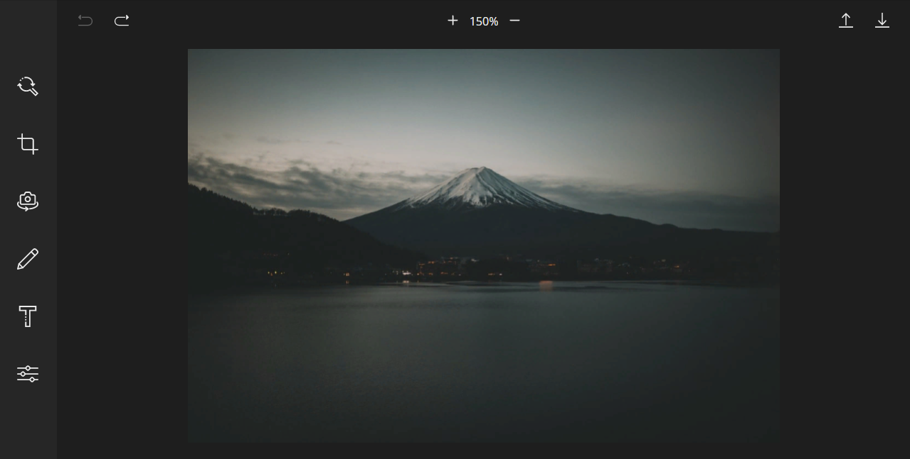
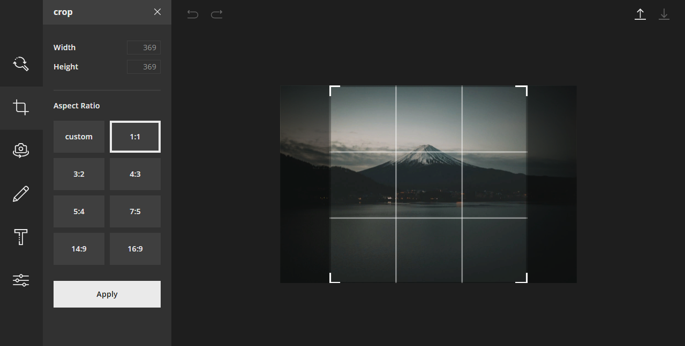
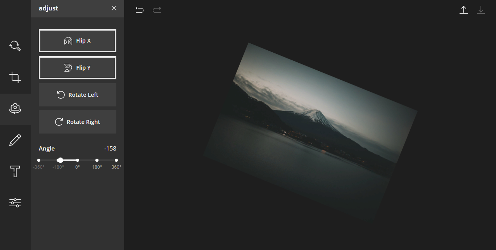
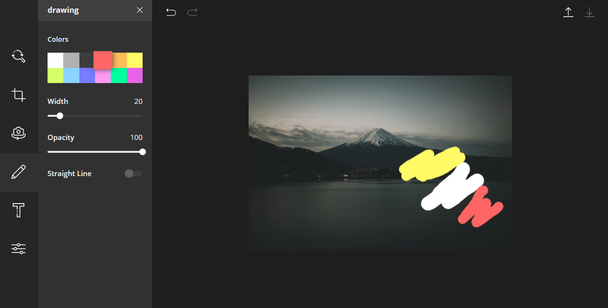
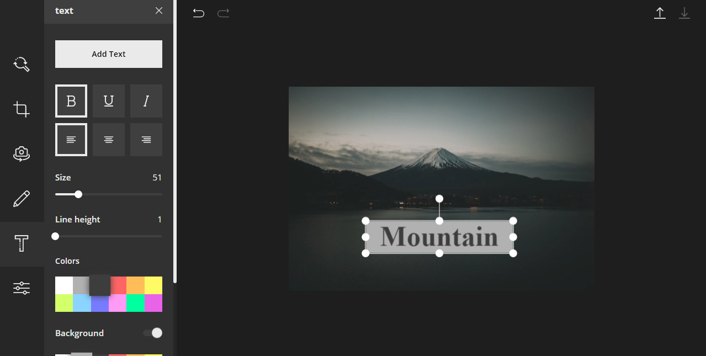
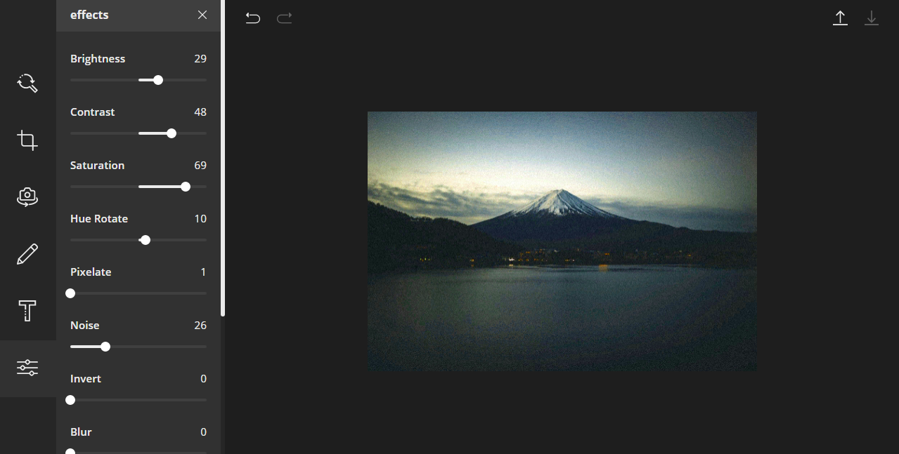
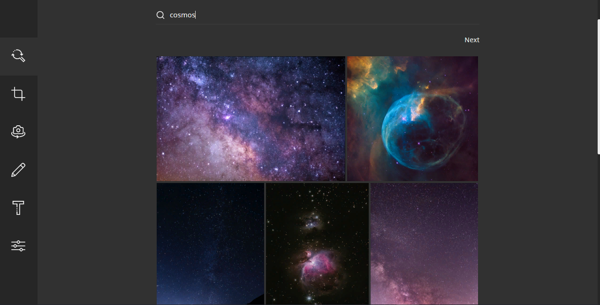

## Features

- Load Image (from Unsplash or from PC)
- Save Image
- Undo/Redo
- Crop
- Flip
- Free Rotation
- Free Drawing
- Line Drawing
- Text
- Filters
- Zoom

## Stack

- React js
- TypeScript
- MobX
- Fabricjs

## Screenshots


<pre>


</pre>

<pre>


</pre>

<pre>


</pre>

<pre>


</pre>

<pre>


</pre>

<pre>


</pre>

<pre>


</pre>

## Setup Instructions

### Setting up the `.env` file

1. Create a new file named `.env` in the root directory of the project.
2. Copy the contents of the `.example.env` file into the newly created `.env` file.
3. Replace the placeholder values in the `.env` file with your actual configuration values.

### Running the Project

1. Ensure you have all the necessary dependencies installed by running:
   ```
   npm install
   ```

2. Start the development server:
   ```
   npm start
   ```

3. Open your browser and navigate to `http://localhost:3000` to view the application.

### Additional Notes

- Make sure to update the `.env` file with the correct API keys and endpoints.
- Refer to the documentation for any additional setup or configuration instructions.
